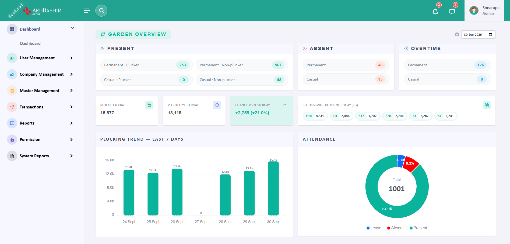
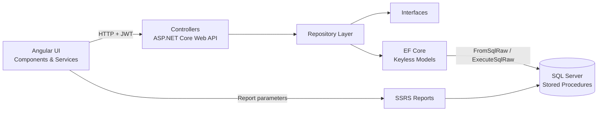

# Tea Estate - Tea Garden HR, Attendance & Payroll System

An enterprise ERP for tea garden operations that manages worker attendance, wages, leave, bonus and provident fund across multiple garden units, with role-based access control and SSRS reporting.




<p align="center"><em>Garden overview dashboard: daily attendance, overtime, section-wise plucking, 7-day plucking trend and attendance breakdown</em></p>

---

## Overview

Tea estates employ large workforces of permanent and casual workers whose pay depends on daily attendance, the type of work done (plucking, pruning and other field work), overtime, leave and off-day rules. TeaLink replaces manual registers and spreadsheet-based wage calculation with a centralized system that:

- Captures daily attendance from a face-capture mobile app and from bulk Excel uploads
- Applies wage, overtime, leave and off-day rules automatically by worker type
- Generates wage sheets, bonus and provident fund data for each garden unit
- Provides management with a live dashboard and filterable operational reports

The system is in production use across **three tea garden units**.

> **Role:** Sole developer: requirement analysis, database design, back end, front end, reporting, and ongoing user support.

---

## Key Features

### Attendance Management

- Separate plucking and non-plucking attendance workflows
- Attendance intake from a face-capture mobile app and Excel bulk upload, with validation
- Daily attendance generation covering present, absent, leave, holiday and weekly off-day status

### Wage & Payroll

- Rule-based wage calculation by worker type (permanent, casual and other casual categories)
- Overtime and off-day pay handling according to management rules
- Wage sheet generation and summaries per unit, book and period

### Leave, Bonus & Provident Fund

- Leave application and year-wise balance tracking
- Maternity leave pay calculated from configurable management rules
- Annual bonus generated from the previous year's attendance
- Provident fund summaries for permanent workers

### Role-Based Access Control (RBAC)

- JWT authentication with custom claims for user, unit and user type
- Permission enforced at three levels:
  - **API:** custom `[Permission]` action filter on write endpoints
  - **Routes:** Angular route guard
  - **UI:** structural directive (`*hasPermission`) hides actions the user cannot perform
- Menu items filtered per operator based on assigned permissions

### Dashboard

- Daily workforce statistics per garden unit
- Section-wise plucking overview
- 7-day plucking trend and attendance charts (ApexCharts)

### Reporting (SSRS)

A unified report launcher with multi-select filters (book, employee, division, section, worker type, work type, attendance type) for reports including:

| Category          | Reports                                                                            |
| ----------------- | ---------------------------------------------------------------------------------- |
| Attendance        | Daily Attendance Details, Worker-wise Attendance Details & Summary, Absent Summary |
| Garden Operations | Daily Garden Summary, Green Leaf Summary                                           |
| HR & Payroll      | Wage Sheet, Leave Summary, Bonus Summary, PF Summary                               |

---

## Tech Stack

| Layer         | Technologies                                                       |
| ------------- | ------------------------------------------------------------------ |
| **Front End** | Angular, TypeScript, Bootstrap 5, ApexCharts, ngx-toastr, Boxicons |
| **Back End**  | C#, ASP.NET Core Web API, Entity Framework Core                    |
| **Database**  | Microsoft SQL Server, T-SQL stored procedures                      |
| **Reporting** | SQL Server Reporting Services (SSRS)                               |
| **Security**  | JWT authentication, role-based access control                      |
| **Tools**     | Visual Studio, VS Code, SSMS, Git                                  |

---

## Architecture

The application follows a layered architecture in which business logic for attendance and wage processing lives in SQL Server stored procedures, and each layer has a single responsibility.



**Request flow:** Angular service → API controller (`[Authorize]` + `[Permission]`) → repository (via interface and dependency injection) → EF Core keyless model → stored procedure.

**Design decisions:**

- **Stored-procedure-centric data access:** complex wage and attendance rules run close to the data for performance and transactional integrity.
- **Interface-based repositories:** controllers depend on abstractions, keeping data access replaceable and testable.
- **Unit-scoped data:** every request is scoped to the user's garden unit through JWT claims.

---

## Project Structure

```
Tea-Estate/
├── API/                      # Back end
│   ├── TEALINK.sln
│   └── TEALINK.GARDEN/       # ASP.NET Core Web API (controllers, models, interfaces, repositories)
└── UI/                       # Front end
    ├── src/                  # Angular application (components, services, guards, directives)
    ├── public/
    └── angular.json
```

---

## Getting Started

> **Note:** The production database schema, stored procedures and data are not included in this repository. Configuration values below are placeholders.

### Prerequisites

- [.NET SDK](https://dotnet.microsoft.com/download)
- [Node.js](https://nodejs.org/) and npm
- [Angular CLI](https://angular.dev/tools/cli)
- Microsoft SQL Server
- SQL Server Reporting Services (optional, for reports)

### 1. Clone the repository

```bash
git clone https://github.com/mdabrarhasan/Tea-Estate.git
cd Tea-Estate
```

### 2. Configure and run the API

Update `API/TEALINK.GARDEN/appsettings.json` with your own values:

```json
"ConnectionStrings": {
  "DefaultConnection": "Server=YOUR_SERVER;Database=YOUR_DATABASE;User Id=YOUR_USER;Password=YOUR_PASSWORD;TrustServerCertificate=True"
},
"Jwt": {
  "Key": "YOUR_SECRET_KEY_MIN_32_CHARACTERS"
}
```

Then run:

```bash
cd API
dotnet restore
dotnet run --project TEALINK.GARDEN
```

### 3. Configure and run the UI

Set the API base URL in the Angular connection service, then run:

```bash
cd UI
npm install
ng serve
```

Open `http://localhost:4200` in your browser.

---

## About This Project

TeaLink was developed for the tea estates of **AkijBashir Group**, which is published here with the company's permission for portfolio purposes. All credentials, server addresses and production data have been removed.

## Author

**Md Abrar Hasan**: Full-Stack Developer (ASP.NET Core · Angular · SQL Server)

- GitHub: [https://github.com/mdabrarhasan](https://github.com/mdabrarhasan)
- LinkedIn: [https://linkedin.com/in/mdabrarhasan](https://www.linkedin.com/)
- Email: abrarhasan2616@gmail.com

## License

This source code is proprietary and shared for portfolio review only. All rights reserved.
